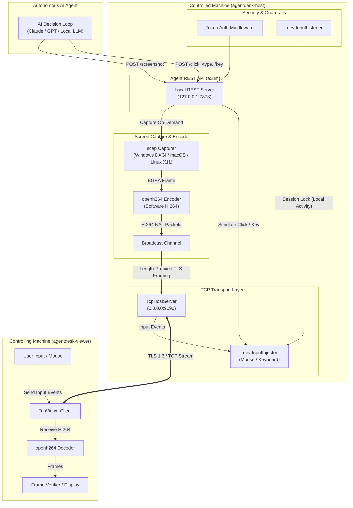

# 🖥️ AgentDesk: Rust Remote Desktop System for AI Agents

[](https://github.com/agentdesk/agentdesk/actions)
[](LICENSE)
[](https://www.rust-lang.org)

**AgentDesk** is a production-grade, low-latency remote desktop system implemented in Rust. It enables **AI Agents to remotely view and control host machines** via a high-performance local REST API (`axum`), while concurrently streaming low-latency H.264 video frames to human observers or monitoring systems.

---

## 🏛️ System Architecture



---

## 📦 Workspace Layout

```
agentdesk/
├── Cargo.toml                     # Cargo workspace configuration
├── crates/
│   ├── core/                      # Shared types, binary framing protocol, config, security
│   ├── capture/                   # Cross-platform screen capture abstraction (scap)
│   ├── input/                     # Input simulation, combo parser, and listener (rdev)
│   ├── encode/                    # H.264 software encoder (openh264) & hardware stubs
│   ├── net/                       # Framed TCP transport with TLS 1.3 & WebRTC trait stubs
│   ├── agent-api/                 # Local axum HTTP API with token auth for AI agents
│   ├── host/                      # Binary: agentdesk-host
│   ├── viewer/                    # Binary: agentdesk-viewer
│   └── integration-tests/         # End-to-end integration test suite
├── signal-server/                 # Binary: agentdesk-signal (WebSocket signaling)
├── .github/workflows/build.yml    # Cross-platform CI matrix (Linux, macOS, Windows)
├── AGENT_API.md                   # OpenAPI & REST API endpoint documentation
├── Makefile                       # Developer shortcuts
└── justfile                       # Modern command runner recipes
```

---

## ⚡ Prerequisites & Installation

### 1. Install Rust
Install Rust stable (2021 edition):
```bash
# Linux & macOS
curl --proto '=https' --tlsv1.2 -sSf https://sh.rustup.rs | sh

# Windows
# Download and run rustup-init.exe from https://rustup.rs
```

### 2. Platform System Dependencies

#### 🐧 Linux (Ubuntu / Debian)
Install X11 development headers:
```bash
sudo apt-get update
sudo apt-get install -y \
    build-essential \
    pkg-config \
    libx11-dev \
    libxtst-dev \
    libxdo-dev \
    libxcb1-dev \
    libxrandr-dev \
    libasound2-dev \
    libxfixes-dev \
    clang
```

> [!IMPORTANT]
> **Linux Session Type Notice**: Wayland restricts background screen capture and synthetic input simulation by design. **You must log into an X11 session** (e.g. choose *"Ubuntu on Xorg"* at the login screen). AgentDesk automatically detects `XDG_SESSION_TYPE` and prints an explicit guide if run under Wayland.

#### 🍏 macOS
Install dependencies via Homebrew:
```bash
brew install pkg-config cmake
```

> [!IMPORTANT]
> **macOS Permissions Notice**: macOS requires explicit user grants for screen capture and synthetic input:
> 1. **Screen Recording**: `System Settings > Privacy & Security > Screen Recording` -> Enable for your terminal app (Terminal/iTerm2).
> 2. **Accessibility**: `System Settings > Privacy & Security > Accessibility` -> Enable for your terminal app.

#### 🪟 Windows
No special manual permissions needed. Windows uses native DXGI desktop duplication and Win32 input APIs. Ensure the Visual Studio C++ Build Tools are installed.

---

## 🚀 Quickstart Guide

### 1. Build the Workspace
```bash
cargo build --workspace --release
```

### 2. Run the Host Server
On the machine you wish to view and control:
```bash
# Start host with default settings (TCP on 9090, Agent API on 127.0.0.1:7878)
cargo run -p agentdesk-host -- --token "super-secret-token"
```

For automated headless testing or CI environments without physical monitors:
```bash
cargo run -p agentdesk-host -- --token "super-secret-token" --mock-display --no-tls
```

### 3. Run the Viewer Client
On the controlling machine:
```bash
# Connect to host and decode H.264 stream
cargo run -p agentdesk-viewer -- --connect 127.0.0.1:9090 --token "super-secret-token"
```

To save decoded frames to disk for inspection:
```bash
cargo run -p agentdesk-viewer -- --connect 127.0.0.1:9090 --token "super-secret-token" --save-frames ./frames --max-frames 50
```

---

## 🤖 Controlling Host with an AI Agent

The controlled host exposes a local REST API bound to `127.0.0.1:7878`. AI agents consume this API in an autonomous loop:

### Example AI Agent Loop (Python)

```python
import base64
import time
import requests

API_BASE = "http://127.0.0.1:7878"
TOKEN = "super-secret-token"
HEADERS = {"Authorization": f"Bearer {TOKEN}"}

def get_screenshot() -> bytes:
    """Captures the current desktop screen as PNG bytes."""
    resp = requests.post(f"{API_BASE}/screenshot", headers=HEADERS, json={})
    resp.raise_for_status()
    data = resp.json()
    return base64.b64decode(data["png_base64"])

def click(x: float, y: float, button: str = "left", clicks: int = 1):
    """Simulates clicking at coordinate (x, y)."""
    requests.post(
        f"{API_BASE}/click",
        headers=HEADERS,
        json={"x": x, "y": y, "button": button, "clicks": clicks},
    ).raise_for_status()

def type_text(text: str):
    """Simulates typing text into the focused window."""
    requests.post(f"{API_BASE}/type", headers=HEADERS, json={"text": text}).raise_for_status()

def press_key(combo: str):
    """Simulates key combinations (e.g. 'ctrl+shift+t', 'enter')."""
    requests.post(f"{API_BASE}/key", headers=HEADERS, json={"combo": combo}).raise_for_status()

def run_agent_loop():
    print("🤖 Agent loop started...")
    
    # Check health
    health = requests.get(f"{API_BASE}/health").json()
    print(f"Connected to host running on: {health['platform']}")

    # 1. Capture screen
    png_bytes = get_screenshot()
    print(f"Captured screenshot ({len(png_bytes)} bytes)")

    # 2. (Pass png_bytes to Vision LLM / Multi-modal model to decide action)
    # e.g.: target_x, target_y = vision_model.locate_button("Submit", png_bytes)
    target_x, target_y = 500.0, 300.0

    # 3. Execute action
    print(f"Clicking at ({target_x}, {target_y})")
    click(target_x, target_y)

    time.sleep(0.5)

    # 4. Type command
    print("Typing prompt...")
    type_text("ls -la\n")

if __name__ == "__main__":
    run_agent_loop()
```

Refer to [`AGENT_API.md`](AGENT_API.md) for full OpenAPI specifications and cURL examples.

---

## 🔒 Security Architecture

1. **Localhost Binding**: The Agent API strictly binds to `127.0.0.1` by default. If bound to `0.0.0.0`, a prominent terminal security warning is emitted.
2. **Bearer Token Authentication**: All requests require `Authorization: Bearer <token>`. Tokens are verified using **constant-time comparisons** (`subtle::ConstantTimeEq`) to prevent side-channel timing attacks.
3. **Transport Layer Security (TLS 1.3)**: Viewer-to-Host communication uses TLS via `rustls`. Hosts generate in-memory certificates and print SHA-256 fingerprints for pinning.
4. **Session Lock Guardrail**: When `--session-lock` is enabled on the host, any physical mouse or keyboard activity detected by the local user automatically drops/pauses remote synthetic input commands.

---

## 🧪 Testing

Run all unit and end-to-end integration tests:
```bash
cargo test --workspace -- --nocapture
```

The integration test suite (`crates/integration-tests`) runs a local host and viewer on loopback, authenticates, streams 10 video frames, verifies all frames decode cleanly, tests the REST API endpoints, and performs a clean shutdown.

---

## 📜 License

Dual licensed under [MIT](LICENSE-MIT) or [Apache-2.0](LICENSE-APACHE).
